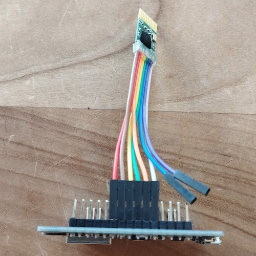

# Philips LivingColors 1st generation component for ESPHome.

[![GitHub Release][releases-shield]][releases]
[![Licence][license-shield]][license]
[![Maintainer][maintainer-shield]][maintainer]  
[![GitHub Sponsors][github-shield]][github]
[![PayPal][paypal-shield]][paypal]
[![BuyMeCoffee][buymecoffee-shield]][buymecoffee]
[![Patreon][patreon-shield]][patreon]

## Introduction

This [ESPHome External Component](https://esphome.io/components/external_components) can emulate
the Philips LivingColors 1st generation LED light and accompanying remote control. It requires
ESPHome 2026.11.0 or newer.

[](https://youtu.be/AeJ-u4nzVQo "Watch the video")

Features:
- Sending commands to the LivingColors LED light
- Receiving commands from LivingColors LED light and LivingColors remote control
- Enable native color cycling light effect
- Pair/unpair LivingColors LED light

### Identifying a 1st generation LivingColors LED light

This ESPHome component only works with the 1st generation of LivingColors LED lights, not with the
2nd generation or later. A 1st generation can be recognised by the 4 LEDs (2 red, 1 green, 1 blue)
and a power supply which gives 5.6 Volts. The 1st generation remote control is not marked as such.

|      |1st generation|2nd generation|
|-----:|:------------:|:------------:|
|LEDs  |    4 LEDs    |    7 LEDs    |
|Power |   5.6 Volt   |  18.5 Volt   |
|Remote|  No marking  |     GEN2     |

## Hardware required

- Philips LivingColors 1st generation LED light
- ESP8266, ESP32 or other ESPHome supported microcontroller
- CC2500 transceiver module

## Wiring

The solder pads of the CC2500 transceiver are just a bit closer spaced than the width of a ribbon
cable, you need a steady hand to solder the wires.



But I've created a Wemos mini Shield that is tested with the D1 mini and C3 mini. Contact me if you
like to buy one!


|     CC2500      |Wemos D1 mini<br/>Shield V2|Wemos C3 mini<br/>Shield V2|
|:---------------:|:-------------:|:-------------:|
|       GND       |      GND      |      GND      |
|       VDD       |      3V3      |      3V3      |
|       SI        |     GPIO13    |     GPIO4     |
|      SCLK       |     GPIO14    |     GPIO2     |
|       SO        |     GPIO12    |     GPIO3     |
| GDO2 (interrupt)|     GPIO15    |     GPIO5     |
|      GDO0       |       A0      |     GPIO0     |
|       CSn       |     GPIO16    |     GPIO1     |

For other configurations you can check the [ESPHome CC2500 component](https://github.com/rrooggiieerr/esphome-cc2500).

## LivingColors 1st generation commands

The data needed to control the LivingColors LED light consists of a 14 byte packet which contains:
- 4 byte light address
- 4 byte remote address
- 1 byte fixed value, always 0x11
- 1 byte command
- 1 byte serial number, increases by 1 on every transmit
- 3 byte HSV color data

## ESPHome example configuration

To set up this LivingColors component, you first need to place a top-level SPI and CC2500 component
which defines the GPIO pins to use.

Example YAML for Wemos C3 mini and CC2500 shield:

```
esphome:
  name: livingcolors1
  friendly_name: LivingColors 1st generation

external_components:
  - source:
      type: git
      url: https://github.com/rrooggiieerr/esphome-cc2500
      # ref: 0.0.3
    components: [cc2500]
  - source:
      type: git
      url: https://github.com/rrooggiieerr/esphome-livingcolors1
      # ref: 0.0.3
    components: [livingcolors1]

esp32:
  board: lolin_c3_mini
  variant: esp32c3

# Enable logging
logger:
  level: INFO

# Enable Home Assistant API
api:
  encryption:
    key: ...

ota:
  - platform: esphome
    password: ...

wifi:
  ssid: !secret wifi_ssid
  password: !secret wifi_password

# Boot button, hold for 3 seconds to pair
binary_sensor:
  - platform: gpio
    id: boot_button
    pin:
      number: GPIO9
      mode:
        input: True
        pullup: True
      inverted: True
      ignore_strapping_warning: True
    # Debouncing
    filters:
      - delayed_on: 50ms
    internal: True
```

CC2500 settings for Wemos D1 mini and CC2500 Shield V2.0

```
spi:
  clk_pin: GPIO14
  mosi_pin: GPIO13
  miso_pin: GPIO12

cc2500:
  cs_pin: GPIO16
  gdo0_pin: A0
  gdo2_pin: GPIO15 # Interrupt
  output_power: 0xFF
```

SPI settings for Wemos C3 mini and CC2500 Shield V2.0

```
spi:
  clk_pin: GPIO2
  mosi_pin: GPIO4
  miso_pin: GPIO3

cc2500:
  cs_pin: GPIO1
  gdo0_pin: GPIO0
  gdo2_pin: GPIO5 # Interrupt
  output_power: 0xFF
```

LivingColors settings

```
livingcolors1:

button:
  - platform: livingcolors1
    pair:
      name: "Pair LivingColors"
    learn:
      name: "Learn LivingColors"
    unpair:
      name: "Unpair LivingColors"

light:
  - platform: livingcolors1
    name: "LivingColors"
    address: 0x...
    restore_mode: RESTORE_DEFAULT_OFF
```

Instead of these LivingColors settings you can include the ones of the devices in this repository.
The second package adds learning and pairing with the boot button defined above on ESP32, see
[Adding LivingColors LED lights](#adding-livingcolors-led-lights).

```
packages:
  livingcolors1: github://rrooggiieerr/esphome-livingcolors1/livingcolors1.yaml@master
  livingcolors1_learning: github://rrooggiieerr/esphome-livingcolors1/livingcolors1-learning.yaml@master
```

## Adding LivingColors LED lights

With the C3 mini configurations in this repository you add LivingColors LED lights with the
buttons on the device page in Home Assistant, or for pairing with the boot button on the ESP. Once
added, the ESP restarts and the light appears in Home Assistant, where you can rename it. Up to 16
lights can be added.

### With the LivingColors remote control

Press the Learn LivingColors button, then switch the light on or off or change its color with the
remote control within 30 seconds. All lights that react to the remote control are added, and the
remote control keeps working.

### Without the LivingColors remote control

Keep the ESP close to the light and press the Pair LivingColors button, or hold the boot button on
the ESP for 3 seconds. The light is now paired with the ESP; a remote control it was paired with no
longer works.

The ESP pairs as its own remote control, with an address based on its MAC address. Lights paired
with one ESP therefore only work with that ESP; when you replace the ESP, pair them again.

### Removing a light

Press the Unpair LivingColors button to unpair the lights that are paired with the ESP. They are
unpaired, the ESP restarts and they are no longer offered to Home Assistant. Unpairing reaches
further than pairing, so all lights paired with the ESP within reach are unpaired. Lights learned
from a remote control are not unpaired. The button is disabled by default to prevent accidental
unpairing, enable it on the device page in Home Assistant first.

To remove a light learned from a remote control, pair it with the ESP first and then unpair it.
This also unpairs it from the remote control; pair it with the remote control again to keep using
it.

A factory reset removes all added lights, together with the Wi-Fi settings. With the factory
configurations in this repository you do a factory reset by pressing the boot button twice and
then holding it for 5 seconds.

## Detecting the LivingColors address

With your own configuration, or on ESP8266, you can also detect the address needed to send and
receive LivingColors commands. You need to enable info loglevel in your ESPHome configuration and
keep the log console open. When a new LivingColors address is detected, the address will be printed
to the ESPHome console. You can then use this address in the button and light components.

### Use the LivingColors remote control

Flash your ESP with the above example configuration YAML except for the button and light
components. Control your LivingColors LED light with the LivingColors remote control, it doesn't
really matter in which way you control it. Switching on/off or changing the color, anything does.
When the LivingColors component detects the command it will print the address to the logging
console.

### Pairing the LivingColors LED light from the ESP

This method is particularly useful if you don't have the remote control. Flash your ESP with the
above example configuration YAML except for the light component. Pair the light as described
above with the Pair LivingColors button, when pairing is successful the address is printed to the
logging console.

The remote address the ESP pairs with is the last 4 bytes of its MAC address, so it's unique to the
ESP. To pair with another remote address, set `address` on the button component to `0xFFFFFFFF`
followed by that remote address.

### Lights without address

On ESP32 a light without `address` gets its address from pairing or learning, and is hidden until
then. The address is stored by the light's `id`, which is required for these lights; the name can be
changed. The ESP8266 has too little storage for this.

```
light:
  - platform: livingcolors1
    id: livingcolors1_light_1
    name: "LivingColors 1"
    restore_mode: RESTORE_DEFAULT_OFF
```

## Improve command reception

If your LivingColors LED light skips commands the distance between the light and the CC2500 module
might be on the limit resulting in range issues. You can increase the number of commands repeats
the code sends by setting the `send_repeats` parameter of the `light` component. The default number
of repeats is 7, just like the LivingColors remote is sending.

```
light:
  - platform: livingcolors1
    name: "LivingColors"
    address: 0x...
    send_repeats: 15
    restore_mode: RESTORE_DEFAULT_OFF
```

## Contribution and appreciation

You can contribute to this component, or show your appreciation, in the following ways.

### Star this external component

Help other ESPHome and Philips LivingColors 1st generation users find this external component by
starring this GitHub page. Click **⭐ Star** on the top right of the GitHub page.

### Support my work

Do you enjoy using this ESPHome component? Please consider supporting my work through one of the
following platforms, your donation is greatly appreciated and keeps me motivated:

[![GitHub Sponsors][github-shield]][github]
[![PayPal][paypal-shield]][paypal]
[![BuyMeCoffee][buymecoffee-shield]][buymecoffee]
[![Patreon][patreon-shield]][patreon]

### ESPHome support

[Book a one-hour ESPHome support session](https://buymeacoffee.com/rrooggiieerr/e/470127). I’ll
help you troubleshoot your ESPHome setup or answer your ESPHome-related questions.

What can be done in one hour:
- ESPHome walktrough, I explain to you how ESPHome works
- Assistance setting up your ESP device
- Install and configure an ESPHome (External) Component

What takes more time:
- Support for ESPHome Component developers

### Hire me

If you would like to have an ESPHome component developed for your product or are in need for a
freelance ESP developer for your project please contact me, you can find my email address on
[my GitHub profile](https://github.com/rrooggiieerr).

[releases]: https://github.com/rrooggiieerr/esphome-livingcolors1/releases
[releases-shield]: https://img.shields.io/github/v/release/rrooggiieerr/esphome-livingcolors1?style=for-the-badge
[license]: ./LICENSE
[license-shield]: https://img.shields.io/github/license/rrooggiieerr/esphome-livingcolors1?style=for-the-badge
[maintainer]: https://github.com/rrooggiieerr
[maintainer-shield]: https://img.shields.io/badge/MAINTAINER-%40rrooggiieerr-41BDF5?style=for-the-badge
[paypal]: https://paypal.me/seekingtheedge
[paypal-shield]: https://img.shields.io/badge/PayPal-00457C?style=for-the-badge&logo=paypal&logoColor=white
[buymecoffee]: https://www.buymeacoffee.com/rrooggiieerr
[buymecoffee-shield]: https://img.shields.io/badge/Buy%20Me%20a%20Coffee-ffdd00?style=for-the-badge&logo=buy-me-a-coffee&logoColor=black
[github]: https://github.com/sponsors/rrooggiieerr
[github-shield]: https://img.shields.io/badge/sponsor-30363D?style=for-the-badge&logo=GitHub-Sponsors&logoColor=ea4aaa
[patreon]: https://www.patreon.com/seekingtheedge/creators
[patreon-shield]: https://img.shields.io/badge/Patreon-F96854?style=for-the-badge&logo=patreon&logoColor=white
